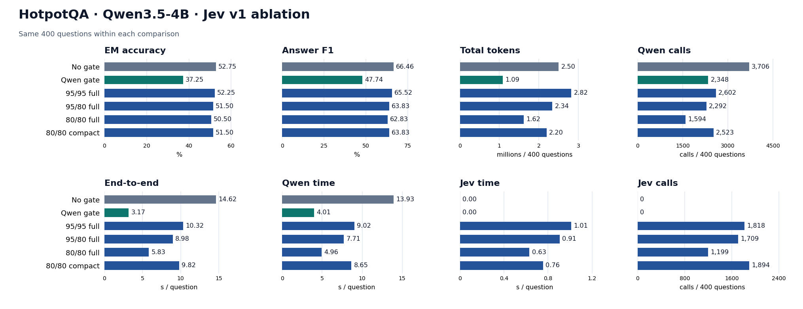
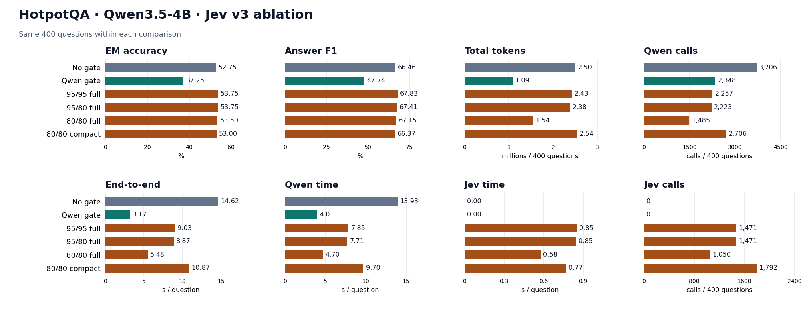
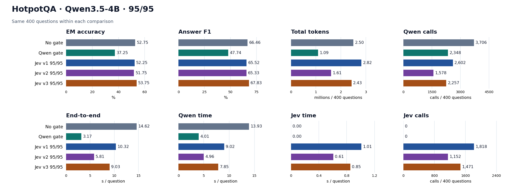
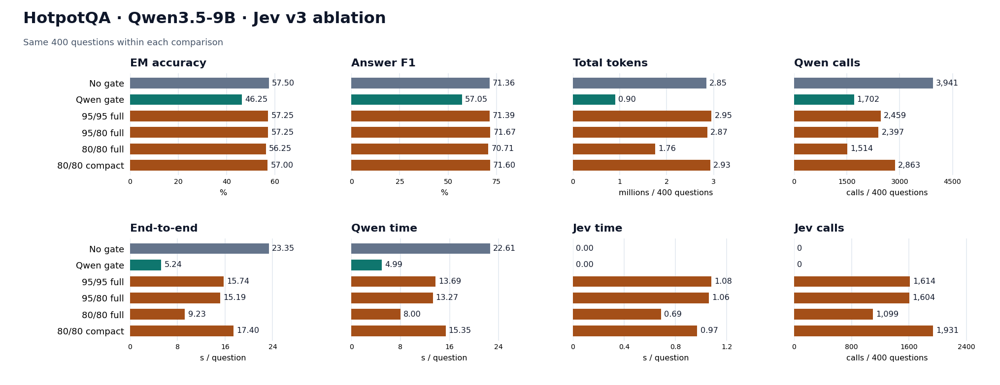
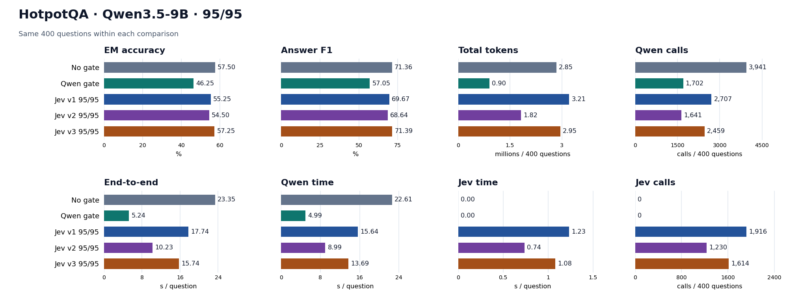

# Jev-RAG Toolbox

Train and evaluate Jev gates for iterative retrieval-augmented generation. The joint models use one adapter and readout for evidence sufficiency and follow-up necessity.

## Quick start with a three-hop replay

In which country is the observatory where the author of *The Glass Meridian* first catalogued a comet? This fictional example follows the evidence from **book → author → observatory → country**. A follow-up about the publication year adds a distractor.

```bash
python -m pip install -e .
python examples/replay_demo.py
```

The demo uses deterministic adapters and runs without a GPU, weights, or an API key. It writes a strategy comparison, a diagnosis, and two branch replays.

| Demo policy | Final answer | EM | Generation calls | Gate calls |
| --- | --- | ---: | ---: | ---: |
| No gate | Chile | 1 | 11 | 0 |
| Qwen gate (simulated) | Chile | 1 | 11 | 7 |
| Jev gate (simulated) | Aster Ridge Observatory | 0 | 7 | 6 |

- **Locate the divergence.** The Jev policy skips the publication-year follow-up but stops when it finds the observatory name, before finding the country.
- **Replay the sufficiency decision.** Forcing the same node to continue changes the answer to Chile, using 3 more generation calls and 1 more gate call.
- **Replay the necessity decision.** Forcing the publication-year follow-up costs 1 additional generation call and leaves the final answer unchanged.

[Demo outputs and replay commands](docs/EXPERIMENTS.md#offline-three-hop-demo) · [Reproduce the HotpotQA comparison](docs/EXPERIMENTS.md#reproduce-the-hotpotqa-400-comparison)

## Model weights

Toolbox releases use `toolbox-vX.Y.Z`. Joint gate checkpoints use `jev-joint-vN`, shown as Jev v1, v2, and v3 in experiment figures.

| Checkpoint | Training | Download |
| --- | --- | --- |
| `jev-joint-v1` | Joint training on the original sufficiency data and teacher-labeled necessity data | [Download weights](models/README.md#download-v1-weights) |
| `jev-joint-v2` | Joint training on draft sufficiency from recorded RAG trajectories and the original necessity data | [Download weights](models/README.md#download-v2-weights) |
| `jev-joint-v3` | Gate supervision from paired rollouts at the same state, following Wang et al.'s conditional interaction framework | [Download weights](models/README.md#download-v3-weights) |

| Decision | Input | Output |
| --- | --- | --- |
| Evidence sufficiency | Original question and retrieved documents | `sufficient` / `insufficient` |
| Follow-up necessity | Original question, retrieved documents, executed follow-ups, draft answer, pending questions, and candidate follow-up | `execute` / `skip_covered` / `skip_unhelpful` |

In iterative retrieval, a sufficiency decision can end the search and an `execute` decision can trigger retrieval. The controller adds retrieved evidence to the state for the next round. Jev returns choices and probabilities, and the controller handles retrieval, generation, and stopping.

## Benchmark figures

Figures are grouped by the **Qwen generator**. Jev v1, v2, and v3 identify the **gate checkpoints**. Metrics include exact match (EM), F1, total input and output tokens, calls to both models, and end-to-end, Qwen, and Jev time. Calls and tokens are totals over 400 questions. Times are means per question. Thresholds are ordered as sufficiency / necessity. Caching and scheduling can affect timings, and end-to-end and model call times are measured separately. [Result tables and per-question traces](results/README.md)

### Qwen3.5-4B

**HotpotQA 400 ablations.** Each figure includes the no-gate and Qwen-gate baselines plus full-input 95/95, 95/80, and 80/80 and compact-sufficiency 80/80 for one Jev version. [Reproduce the baseline comparison](docs/EXPERIMENTS.md#reproduce-the-hotpotqa-400-comparison) · [v1 data](results/HOTPOTQA400_GATE_ABLATION.md) · [v2 data](results/HOTPOTQA400_V2_ABLATION.md) · [v3 data](results/JEV_V3.md)






**95/95 comparison on matched questions.** HotpotQA and 2Wiki use their respective baselines. The figures compare Jev v1, v2, and v3 at fixed thresholds. [HotpotQA data](results/HOTPOTQA400_V2.md) · [2Wiki v2 data](results/2WIKIMULTIHOPQA400_V2.md) · [v3 data for both datasets](results/JEV_V3.md)




### Qwen3.5-9B

**HotpotQA 400 ablations.** Jev v1, v2, and v3 are each compared with the no-gate and Qwen-gate 9B baselines on the same questions. [v3 results and traces](results/JEV_V3.md)




**95/95 comparison on matched questions.** HotpotQA and 2WikiMultiHopQA have 400 questions each. Capped outputs count as failures and remain in the denominator and cost totals.




## Documentation

| Goal | Guide |
| --- | --- |
| Reproduce experiments, inspect traces, or replay a case | [Experiments and replay](docs/EXPERIMENTS.md) |
| Understand iterative BM25 retrieval and gate settings | [RAG method](docs/ITERATIVE_RAG.md) |
| Use your own data or model, or evaluate one gate | [Custom inputs and adapters](docs/CUSTOM_INPUTS.md) |
| Inspect the datasets and training procedure | [Data card](docs/DATASETS.md) · [Training](docs/TRAINING.md) |
| Download or verify checkpoints | [Model cards](models/README.md) |
| Browse published tables and traces | [Results index](results/README.md) |
| Find configuration, source, and experiment artifacts | [Repository layout](docs/CONVENTIONS.md#directory-layout) |
