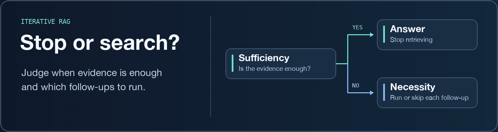
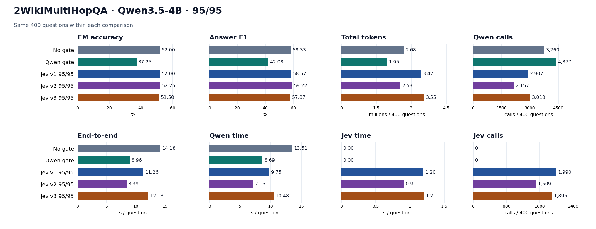
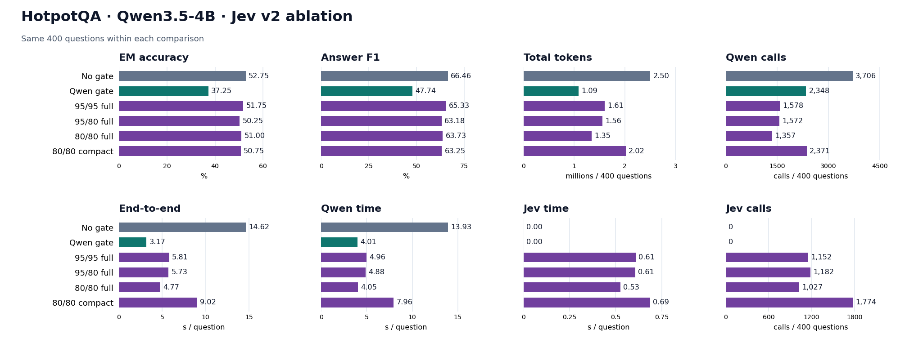
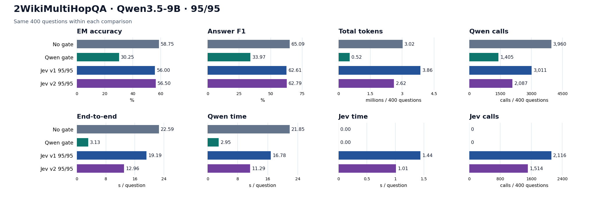
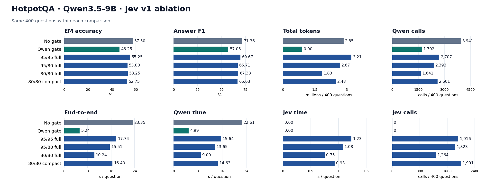

# Jev-RAG Toolbox



Train and benchmark **Jev gates for iterative RAG**. Trace which decisions changed an answer, then replay an individual decision to see what happens when you take a different action.

[Try the demo](#quick-start-with-a-three-hop-replay) · [Download weights](#model-weights) · [See benchmarks](#benchmark-figures) · [Bring your own models and data](docs/CUSTOM_INPUTS.md)

## Quick start with a three-hop replay

```bash
python -m pip install -e .
python examples/replay_demo.py
```

The demo uses deterministic adapters and runs without a GPU, weights, or an API key. It writes a strategy comparison, a diagnosis, and two branch replays.

In which country is the observatory where the author of *The Glass Meridian* first catalogued a comet? The demo follows three hops from **book → author → observatory → country**.

| Demo policy | Final answer | EM | Generation calls | Gate calls |
| --- | --- | ---: | ---: | ---: |
| No gate | Chile | 1 | 11 | 0 |
| Qwen gate (simulated) | Chile | 1 | 11 | 7 |
| Jev gate (simulated) | Aster Ridge Observatory | 0 | 7 | 6 |

<details>
<summary>See what changes when you replay either decision</summary>

- **Sufficiency.** Jev stops at the name of the observatory. Forcing it to continue finds the country with three additional generation calls and one gate call.
- **Necessity.** Jev skips a question about the book's publication year. Forcing that search adds one generation call and leaves the final answer unchanged.

[Demo outputs and replay commands](docs/EXPERIMENTS.md#offline-three-hop-demo)

</details>

## Model weights

Each joint checkpoint provides one adapter and decision readout for both gates. Download scripts assemble and verify the release files.

| Checkpoint | Training data | Download |
| --- | --- | --- |
| `jev-joint-v1` | Original sufficiency data and teacher-labeled necessity data | [Download weights](models/README.md#download-v1-weights) |
| `jev-joint-v2` | Draft sufficiency from recorded RAG trajectories and the original necessity data | [Download weights](models/README.md#download-v2-weights) |
| `jev-joint-v3` | Paired rollouts at the same RAG state, following [Wang et al.'s conditional interaction framework](docs/TRAINING.md#v3-supervision-from-paired-rollouts) | [Download weights](models/README.md#download-v3-weights) |

<details>
<summary>Gate inputs and outputs</summary>

| Decision | Input | Output |
| --- | --- | --- |
| Evidence sufficiency | Original question and retrieved documents. Draft-based settings also include the current answer draft. | `sufficient` / `insufficient` |
| Follow-up necessity | Original question, retrieved documents, executed follow-ups, draft answer, pending questions, and candidate follow-up | `execute` / `skip_covered` / `skip_unhelpful` |

Jev returns choices and probabilities. The controller handles retrieval, generation, and stopping, and adds evidence from executed searches to the next round. [RAG method and gate settings](docs/ITERATIVE_RAG.md)

</details>

## Benchmark figures

Each dataset uses **400 matched questions** and compares no gate, Qwen gating, and Jev gating. Figures are grouped by answer generator. Jev v1–v3 identify the gate checkpoints.

[Result tables and traces](results/README.md) · [Reproduce the 400-question comparison](docs/EXPERIMENTS.md#reproduce-the-hotpotqa-400-comparison)

### Qwen3.5-4B

**HotpotQA · 95/95 sufficiency and necessity thresholds**


<details>
<summary>2WikiMultiHopQA · 95/95</summary>



</details>

<details>
<summary>HotpotQA ablations · Jev v1, v2, and v3</summary>





</details>

### Qwen3.5-9B

<details>
<summary>HotpotQA and 2WikiMultiHopQA · 95/95</summary>




</details>

<details>
<summary>HotpotQA ablations · Jev v1, v2, and v3</summary>




</details>

<details>
<summary>Metrics and ablation settings</summary>

Figures report exact match (EM), F1, total input and output tokens, calls to both models, and end-to-end, Qwen, and Jev time. Calls and tokens are totals across 400 questions. Times are means per question. Caching and scheduling can affect timings. Capped outputs count as failures and remain in the denominator and cost totals.

Ablations compare full-input 95/95, 95/80, and 80/80, and compact sufficiency at 80/80. Thresholds are in sufficiency / necessity order. [v1 data](results/HOTPOTQA400_GATE_ABLATION.md) · [v2 data](results/HOTPOTQA400_V2_ABLATION.md) · [v3 data](results/JEV_V3.md)

</details>

## Documentation

| I want to | Start here |
| --- | --- |
| Reproduce a benchmark, inspect a trace, or replay a decision | [Experiments and replay](docs/EXPERIMENTS.md) |
| Plug in my own models, test sets, or logs | [Custom inputs and adapters](docs/CUSTOM_INPUTS.md) |
| Understand iterative BM25 retrieval and gate settings | [RAG method](docs/ITERATIVE_RAG.md) |
| Train a gate or inspect the training data | [Training](docs/TRAINING.md) · [Data card](docs/DATASETS.md) |
| Download and verify checkpoints | [Model cards](models/README.md) |
| Browse result tables and public traces | [Results index](results/README.md) |
| Find source, configuration, and experiment artifacts | [Repository layout](docs/CONVENTIONS.md#directory-layout) |
