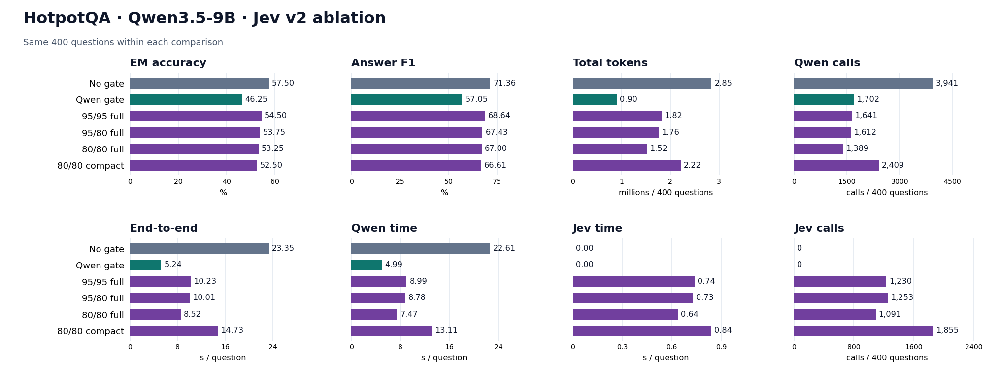

# Jev-RAG Toolbox

训练和评测迭代 RAG 的 Jev 门控。联合模型使用同一套适配器和读出层，支持充分性与必要性判断。

## 快速体验：回放一道三跳题

《The Glass Meridian》的作者第一次记录彗星的天文台，位于哪个国家？这道虚构题需要沿着**书 → 作者 → 天文台 → 国家**找证据。另有一个关于出版年份的干扰追问。

```bash
python -m pip install -e .
python examples/replay_demo.py
```

演示使用确定性适配器，无需 GPU、权重或 API 密钥。一次运行会生成三种策略的对比表、诊断记录和两份分叉回放。

| 演示策略 | 最终答案 | EM | 生成调用 | 门控调用 |
| --- | --- | ---: | ---: | ---: |
| 无门控 | Chile | 1 | 11 | 0 |
| Qwen 门控（模拟） | Chile | 1 | 11 | 7 |
| Jev 门控（模拟） | Aster Ridge Observatory | 0 | 7 | 6 |

- **定位分歧。** Jev 跳过了出版年份追问，却在找到天文台名字后停搜，漏掉了最后一步。
- **回放充分性。** 在同一节点强制继续，多用 3 次生成和 1 次判断，答案从天文台名字变为 Chile。
- **回放必要性。** 在同一节点改为执行出版年份追问，多用 1 次生成，最后仍答错。

[演示产物与回放命令](docs/EXPERIMENTS.md#离线三跳示例) · [复现 HotpotQA 三组对照](docs/EXPERIMENTS.md#复现-hotpotqa-400-题三组对照)

## 模型权重

工具箱代码使用 `toolbox-vX.Y.Z` 标记发布版本。联合门控权重使用 `jev-joint-vN` 标记训练版本，实验图中简写为 Jev v1、v2、v3。

| 权重标识 | 训练方式 | 权重下载 |
| --- | --- | --- |
| `jev-joint-v1` | 原始充分性数据与教师标注必要性数据联合训练 | [下载权重](models/README.md#下载-v1-权重) |
| `jev-joint-v2` | 真实迭代轨迹的草稿充分性与原必要性数据联合训练 | [下载权重](models/README.md#下载-v2-权重) |
| `jev-joint-v3` | 按 Wang 等的条件交互框架，用同状态分叉的实际结果监督门控 | 待发布 |

| 决策 | 输入 | 输出 |
| --- | --- | --- |
| 证据充分性 | 原问题、已检索文档 | `sufficient` / `insufficient` |
| 追问必要性 | 原问题、已检索文档、已执行追问、中间答案、待处理问题、候选追问 | `execute` / `skip_covered` / `skip_unhelpful` |

在迭代搜索中，`sufficient` 可以触发生成最终答案，`execute` 可以触发一次检索。执行后的证据写回状态，供下一轮判断。Jev 返回选项和概率，检索、生成和停止条件由流程代码控制。

## 实验对比图

按 Qwen **生成模型**分组，Jev v1／v2／v3 表示**门控权重**。图中正确率使用 EM，并列出 F1、输入与输出合计 token、两类调用次数，以及端到端、Qwen 和 Jev 耗时。调用与 token 按 400 题累计，耗时按每题平均。门槛按充分性／必要性排列。各次运行的缓存和调度会影响时间，端到端耗时与两类模型调用耗时分别统计。 [结果表与逐题轨迹](results/README.md)

### Qwen3.5-4B

**HotpotQA 400 题消融。** [复现三组对照](docs/EXPERIMENTS.md#复现-hotpotqa-400-题三组对照)。每张图包含无门控和 Qwen 门控两条基线，以及对应 Jev 版本的全输入 95/95、全输入 95/80、全输入 80/80、精简充分性 80/80。 [v1 数据](results/HOTPOTQA400_GATE_ABLATION.md) · [v2 数据](results/HOTPOTQA400_V2_ABLATION.md)


**95/95 同题对照。** HotpotQA 和 2Wiki 分开画，各自使用同题基线。图中已纳入 v1、v2，v3 评测完成后在对应图中新增一行。 [HotpotQA 数据](results/HOTPOTQA400_V2.md) · [2Wiki 数据](results/2WIKIMULTIHOPQA400_V2.md)


### Qwen3.5-9B

**HotpotQA 400 题消融。** Jev v1、v2 各与同题的 9B 无门控和 Qwen 门控对照。




**95/95 同题对照。** HotpotQA 和 2WikiMultiHopQA 各 400 题，权重为 Jev v1 和 v2。触及输出上限的结果按失败计分，保留在 400 题分母和成本中。


## 文档导航

| 我想…… | 去哪里 |
| --- | --- |
| 复现对照、查看轨迹、回放错题 | [实验与回放指南](docs/EXPERIMENTS.md) |
| 了解 BM25 迭代搜索和门控设置 | [RAG 方法](docs/ITERATIVE_RAG.md) |
| 接入自己的数据或模型、评测单项门控 | [自定义输入与适配器](docs/CUSTOM_INPUTS.md) |
| 查看数据来源和训练细节 | [数据卡](docs/DATASETS.md) · [训练复现](docs/TRAINING.md) |
| 下载或核验权重 | [模型卡](models/README.md) |
| 浏览结果表和已发布轨迹 | [结果索引](results/README.md) |
| 找到配置、源码和实验产物的位置 | [仓库结构](docs/CONVENTIONS.md#目录结构) |
